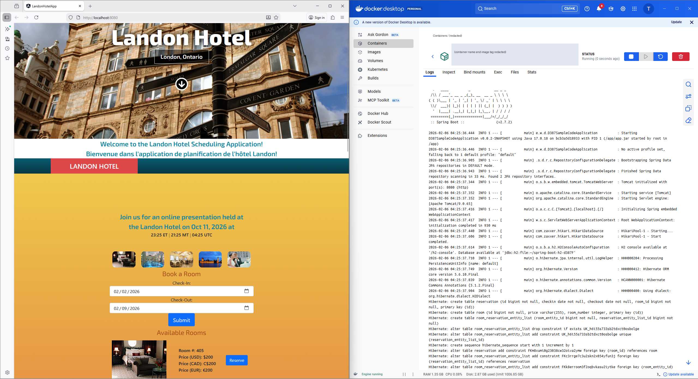
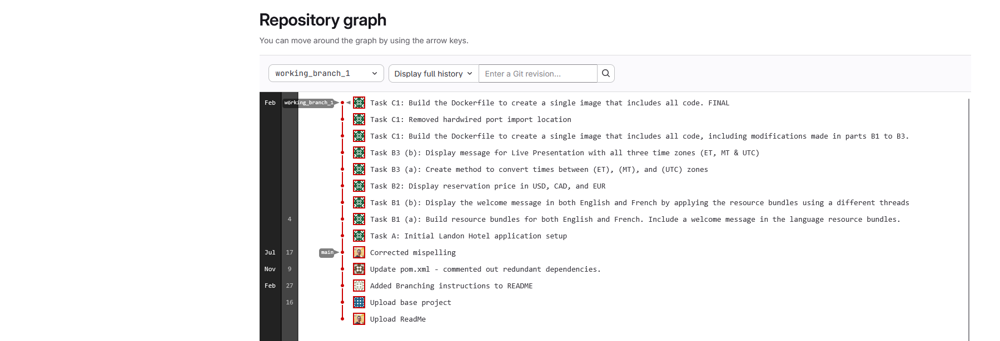

# Containerizing a Spring Boot + Angular App with Docker

My working notes and write-up from WGU's **D387: Advanced Java** course, focused on the part that taught me the most: packaging a full-stack Java/Angular application into a single Docker image, running it as a container, publishing it to Docker Hub, and planning its deployment to Azure.



*The Landon Hotel scheduling app served from `localhost:8080`, running inside a container. Docker Desktop (right) shows the Spring Boot logs from that container.*

## What this project is

The course provides a Landon Hotel scheduling application (Spring Boot back end, Angular front end). The work had three parts:

| Task | What I did |
|------|-----------|
| **A** | Tracked each requirement as its own commit in GitLab |
| **B** | Localized the app: English/French resource bundles loaded on separate threads, prices in USD/CAD/EUR, and a presentation time shown in ET, MT and UTC |
| **C** | **Built a Dockerfile, ran the image as a named container, and wrote up how to deploy it to Azure** |

This repo documents the process, and Task C in particular. It contains the Dockerfile, my setup and troubleshooting notes, and the deployment write-up. The application source stays in my course GitLab repo and isn't copied here.

## Docker skills this demonstrates

- Writing a **Dockerfile** for a Spring Boot fat jar (`FROM`, `WORKDIR`, `COPY`, `EXPOSE`, `ENTRYPOINT`) and understanding what each instruction does
- Picking a **base image** that matches the project's Java version (Temurin 17)
- Using the **build context** correctly: the last argument to `docker build` is the folder, not the Dockerfile
- **Tagging** an image for a registry (`<user>/<image>`) and building with `--no-cache` for a clean rebuild
- Authenticating to **Docker Hub with an access token** instead of a password
- Running and inspecting a **named container** with a port mapping (`8080:8080`) and reading its logs
- Producing a **single image** that holds both the back end and the compiled Angular front end, by letting Maven build the front end into the jar
- Planning a **cloud deployment** (Azure Container Apps), including why the port should come from the environment and not be hard-coded

## How the pieces fit together

```
 Angular source ──┐
                  ├─ mvn package ─▶ one Spring Boot jar ─▶ docker build ─▶ image ─▶ docker run ─▶ localhost:8080
 Spring source ───┘   (builds UI                          (Dockerfile)      │
                       into the jar)                                         └─ docker push ─▶ Docker Hub ─▶ Azure Container Apps
```

## Repository map

| Path | Contents |
|------|----------|
| [`Dockerfile`](Dockerfile) | The Dockerfile I built for the app |
| [`docs/01-environment-setup.md`](docs/01-environment-setup.md) | Java, Node, Angular, Docker Desktop and IntelliJ setup |
| [`docs/02-application-overview.md`](docs/02-application-overview.md) | The app's Task B changes and what they taught me |
| [`docs/03-building-the-jar.md`](docs/03-building-the-jar.md) | Maven lifecycle and producing the jar that Docker packages |
| [`docs/04-dockerfile-explained.md`](docs/04-dockerfile-explained.md) | Docker concepts plus a line-by-line walkthrough of the Dockerfile |
| [`docs/05-build-run-push.md`](docs/05-build-run-push.md) | The commands I used to build, run, log in and publish |
| [`docs/06-azure-deployment.md`](docs/06-azure-deployment.md) | Step-by-step plan for deploying the image to Azure |
| [`docs/07-troubleshooting.md`](docs/07-troubleshooting.md) | Problems I hit and how I solved them |
| [`assets/`](assets) | Screenshots |

## Stack

Java 17 · Spring Boot 2.7.2 · Embedded Tomcat 9 · Spring Data JPA / Hibernate · H2 · Angular 14 · Node 20 LTS · Maven · IntelliJ IDEA · Docker Desktop · Docker Hub · Azure Container Apps

## Version control

Each requirement got its own commit on the `working_branch_1` branch, so the progression from initial setup to the final Dockerfile is visible commit by commit:



## Key lessons

1. **A container is just the image plus a running process.** The Dockerfile only needs to say which Java to use, where the jar goes, and how to start it.
2. **File names in a Dockerfile must match exactly.** A single wrong character in the jar name breaks the build.
3. **The build context is a folder.** Pointing `docker build` at the Dockerfile itself, or at the wrong folder, is an easy mistake.
4. **Don't hard-code the port.** Cloud platforms assign their own, so the app should read it from the environment.
5. **Secrets never belong in notes or repos.** Use access tokens, and rotate any that end up somewhere they shouldn't.

## Security notes

- Docker Hub access tokens are used in place of my account password, with only the permissions needed. No tokens or credentials are stored in this repo.
- My notes mention enabling *Expose daemon on tcp://localhost:2375 without TLS* in Docker Desktop so IntelliJ's Docker integration could connect. That setting lets any local process control Docker with no authentication, so it should be turned off once it's no longer needed.

## Ideas for next steps

These are improvements I haven't implemented yet:

- **Multi-stage build** that compiles the jar (Maven + Node) inside Docker, so the image can be built from a clean checkout, then copies it into a slim runtime image
- **Smaller runtime image**: a JRE instead of the full JDK
- **Run as a non-root user.** The startup logs show the app running as `root` inside the container
- **`.dockerignore`** to keep `.git`, `node_modules` and IDE files out of the build context
- **Persist the database.** The app uses a file-based H2 database inside the container, so reservations are lost when the container is removed; a Docker volume would fix that
- **Image scanning** with Docker Scout, which is already built into Docker Desktop

## Acknowledgements

The Landon Hotel application is the starter project provided by WGU for course D387. This repo covers my own notes, Dockerfile and deployment write-up.
