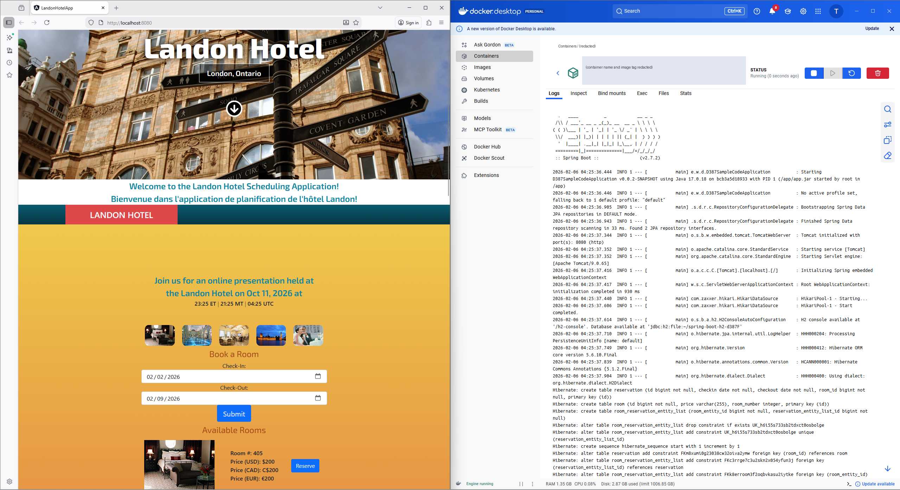

# 5. Build, run, log in, publish

Placeholders used below: `<dockerhub-user>` is your Docker Hub username and `<student-id>` is your course ID. The course requires the container name to include `D387_<student-id>`.

## 1. Build the image

From the project root, after a clean Maven build so `target/` holds a fresh jar:

```powershell
docker build -t <dockerhub-user>/d387_<student-id> "C:\path\to\project"
```

The **last argument is the folder that contains the Dockerfile**, not the Dockerfile itself. If you run the command from the project folder, use `.` for that argument.

I ran my first build from a separate folder (`PS C:\Docker>`) and passed the project path explicitly. It finished in about 12 seconds:

```text
[+] Building 12.7s (8/8) FINISHED
```

For a fully clean rebuild that ignores cached layers:

```powershell
docker build --no-cache -t <dockerhub-user>/d387_<student-id> "C:\path\to\project"
```

Useful checks along the way:

```powershell
docker info      # confirms the engine is running
docker images    # lists local images; the new one should appear
```

The new image also shows up under **Docker Desktop → Images**.

## 2. Run it as a named container

```powershell
docker run -d --name D387_<student-id> -p 8080:8080 <dockerhub-user>/d387_<student-id>:latest
```

- `-d` runs it in the background
- `--name` sets the container name the assignment requires
- `-p 8080:8080` maps my machine's port 8080 to the container's port 8080

Then open `http://localhost:8080`. **Docker Desktop → Containers → *name* → Logs** shows the Spring Boot output:



What the startup log tells me:

- Spring Boot **2.7.2** started on **Java 17.0.18** from `/app/app.jar`
- **Tomcat 9.0.65** initialized on port **8080 (http)**
- Spring Data found **2 JPA repositories**
- Hibernate created the `reservation`, `room` and join tables in an **H2** database

## 3. Log in to Docker Hub with an access token

1. On Docker Hub, open your **Account settings** and create a **personal access token**.
2. Give it the permissions you need (I used read, write and delete).
3. Use the token **as the password** when signing in from the CLI:

```powershell
docker login -u <dockerhub-user>
# paste the access token when prompted for a password
```

To keep the token out of shell history in scripts, pipe it in instead:

```powershell
$env:DOCKER_TOKEN | docker login -u <dockerhub-user> --password-stdin
```

> 🔒 Treat the token like a password. Never paste it into notes, commits, screenshots or documents. If one is ever exposed, delete it on Docker Hub and create a new one.

## 4. Push to Docker Hub

```powershell
docker push <dockerhub-user>/d387_<student-id>:latest
```

The image is published as **public** so Azure can pull it without credentials (see [Azure deployment](06-azure-deployment.md)).

## Command cheat sheet

| Goal | Command |
|------|---------|
| Check Docker is running | `docker info` |
| List images | `docker images` |
| Build an image | `docker build -t <user>/<name> <folder>` |
| Build with no cache | `docker build --no-cache -t <user>/<name> <folder>` |
| Run a named container | `docker run -d --name <name> -p 8080:8080 <image>` |
| List running containers | `docker ps` |
| Read a container's logs | `docker logs <name>` |
| Stop / remove a container | `docker stop <name>` / `docker rm <name>` |
| Log in to Docker Hub | `docker login -u <user>` |
| Publish an image | `docker push <user>/<name>:<tag>` |
